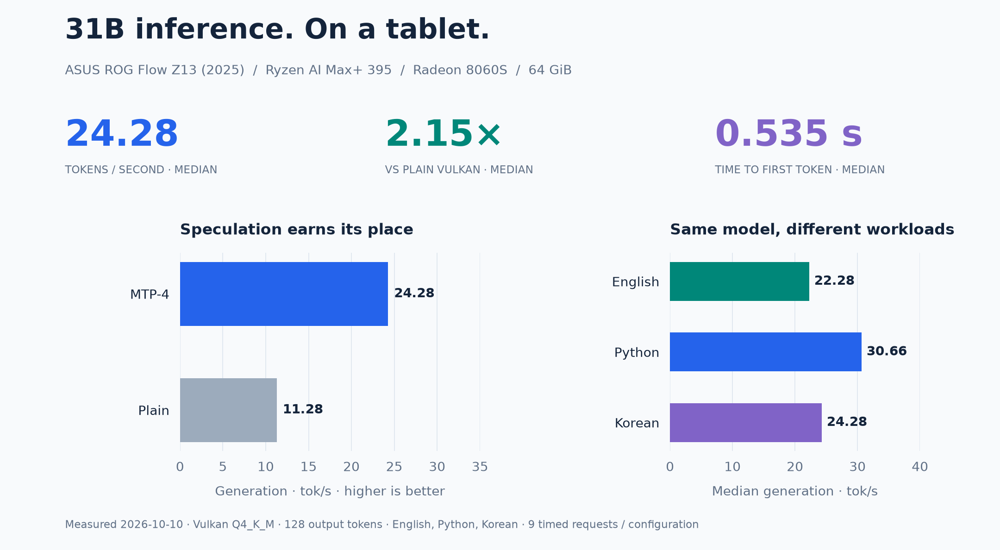
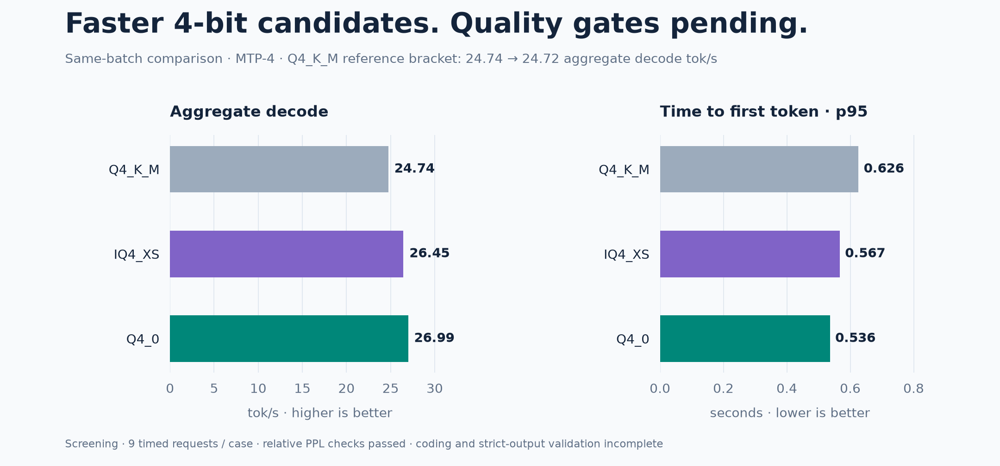
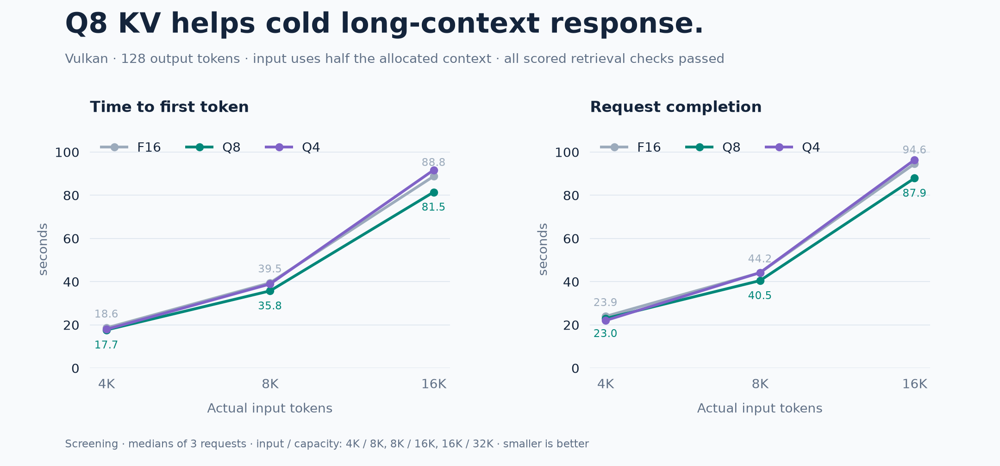
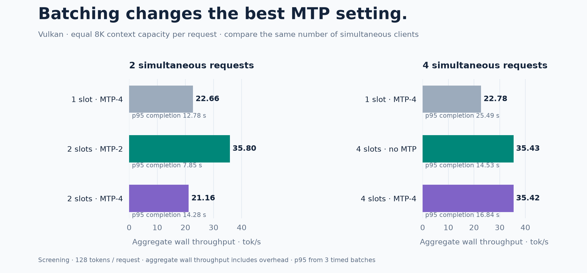

# Gemma 4 · Strix Halo

**Gemma 4 31B inference on the ASUS ROG Flow Z13 (2025).**

Vulkan and HIP benchmarks, an authenticated Compose stack, and experimental kernel patches. Measured **2026-10-10**. Optimization campaign **paused**; the original configuration remains deployed.



## Device & stack

| Component | Measured configuration |
|---|---|
| Device | [ASUS ROG Flow Z13 (2025)](https://rog.asus.com/laptops/rog-flow/rog-flow-z13-2025/) · GZ302EA |
| APU | Ryzen AI Max+ 395 · 16 cores / 32 threads |
| GPU | Radeon 8060S · `gfx1151` |
| Memory | 64 GiB unified · 8000 MT/s · 16 GiB GPU reservation |
| Platform | Fedora 44 · kernel 7.2.9 · Mesa 26.2.3 · ROCm 10.1.0 |
| Runtime | llama.cpp v0.6.0 · Vulkan/RADV |
| Model | Gemma 4 31B Q4_K_M · Q8 MTP assistant |
| Serving | MTP-4 · F16 KV · 8K context · one slot · two CPU threads |

## Results

| Measurement | Result | Status |
|---|---:|---|
| Deployed median generation | **24.28 tok/s** | Deployed; service canaries passed |
| Plain Vulkan median generation | 11.28 tok/s | Comparison baseline |
| Deployed median first token | **0.535 s** | Short inputs |
| Q4_0 aggregate decode | **26.99 tok/s · +9.1%** | Quality validation incomplete |
| Q8 KV first-token latency, 8K input | **35.75 s · −9.45%** | Screening candidate |
| Two concurrent requests, MTP-2 | **35.80 tok/s aggregate** | Screening candidate |

Short-input generation uses English, Python, and Korean prompts, 128 output tokens, and reasoning disabled. Median decode, aggregate decode, and wall throughput are distinct metrics. Relative candidate gains use their own batch reference; no follow-up candidate is promoted.

### 4-bit candidates



Q4_0 and IQ4_XS passed the selected relative perplexity checks. Coding and strict-output quality gates remain incomplete.

### Long contexts



Q8 KV helps cold response. Q4 KV does not consistently help. All scored retrieval checks passed; reused prefixes also benefit the original configuration.

### Concurrent requests



Two slots with MTP-2 outperform two requests queued through the baseline by **58%**. At four clients, disabling MTP delivers similar throughput with lower completion latency than MTP-4.

## Reproduce

```sh
git clone https://github.com/han-minhee/gemma4-strix-halo.git
cd gemma4-strix-halo
```

- [Setup](docs/setup.md) — dependencies, model verification, Compose deployment.
- [Methodology](docs/methodology.md) — workloads, metric definitions, quality gates.
- [Experiments](docs/experiments.md) — speculation, kernel profiling, rejected approaches.
- [Data](data/README.md) — numeric request evidence and provenance.

Regenerate all six charts, including editable SVGs:

```sh
python3 -m venv .venv
.venv/bin/pip install -r tools/requirements-charts.txt
.venv/bin/python tools/render_charts.py
```

## Boundaries

No NPU acceleration was established. No boot or memory-reservation changes were applied during the follow-up campaign. Final paired comparisons, sustained-load validation, and separate deployment presets remain unfinished.

Code is MIT licensed. Model weights and upstream dependencies retain their own licenses; weights are downloaded separately. See [third-party notices](THIRD_PARTY_NOTICES.md).
