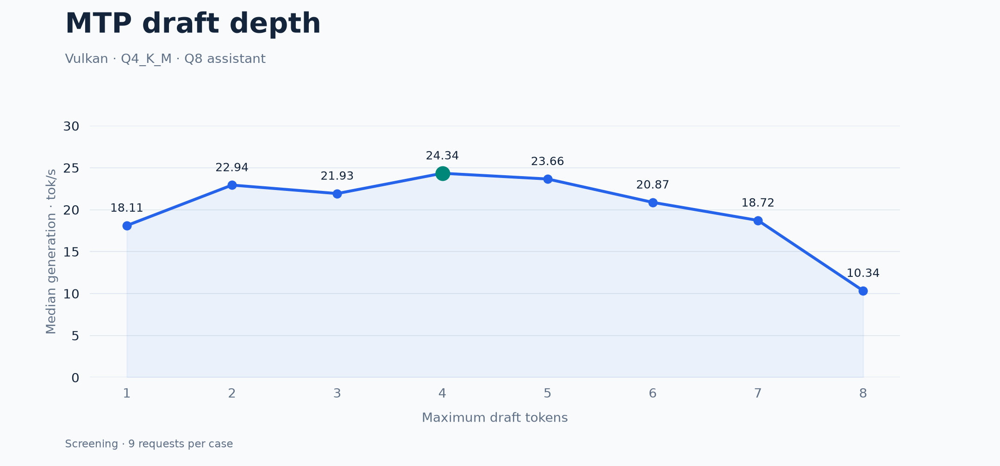
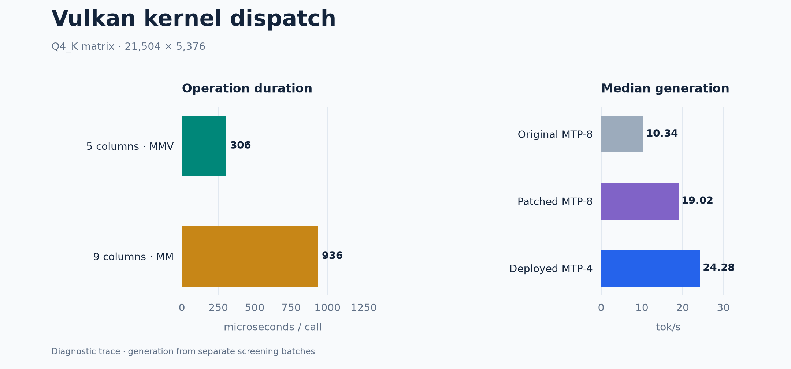

# Experiments

## MTP depth

Depth 4 remains the reference. Confidence filtering and adaptive MTP produced no qualifying gain.

## Kernel dispatch

The 16-column dispatch patch improved MTP-8 but did not beat MTP-4. Selected numerical checks passed. The HIP wide-attention patch remains unqualified.

## Results

| Approach | Result |
|---|---|
| CPU-only | 4.10 tok/s · synthetic benchmark |
| Q4 assistants | About 2% faster · below promotion threshold |
| CPU affinity / polling | 23.62–23.72 median tok/s |
| ROCmFP4, plain decode | 11.97 Vulkan / 10.95 HIP aggregate tok/s |
| ROCmFPX MTP repairs | Model-level validation failed |
| Four-slot HIP | 4800 MiB KV allocation failed |
| NPU | No executable 31B target/assistant path established |

Pending: coding/strict-output gates, thermal stabilization, ten-pair comparisons, sustained-load and restart checks. No experimental preset was deployed.

[Patches](../patches/) · [Methodology](methodology.md) · [Source pins](../experiments/sources.json)
